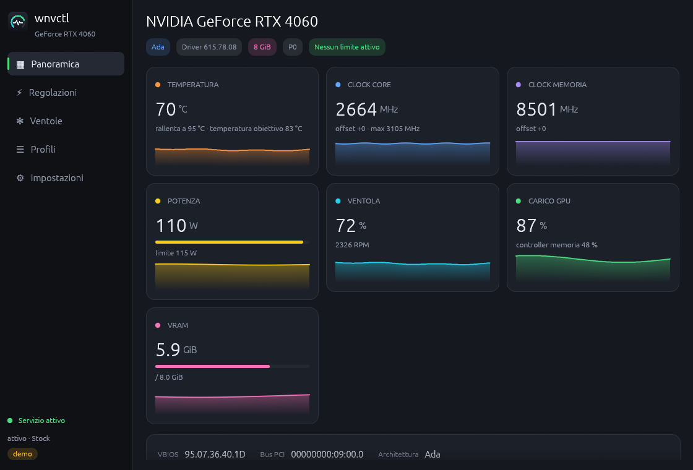
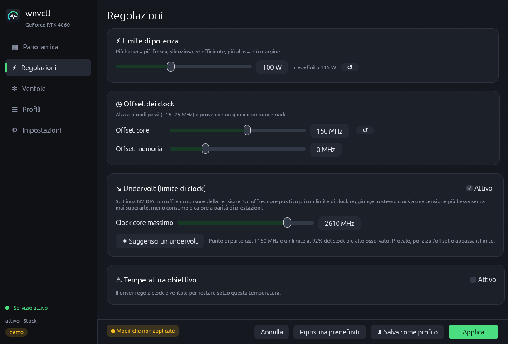
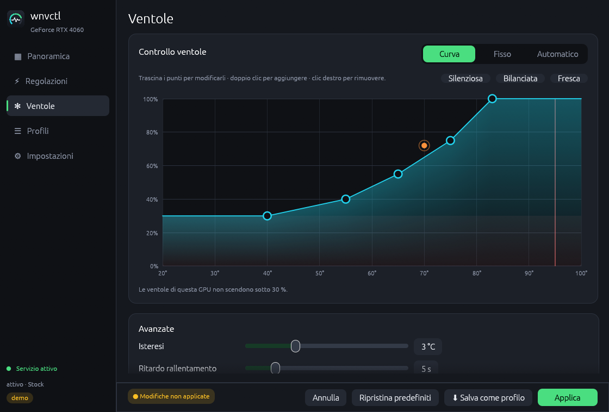

# wnvctl — controllo GPU NVIDIA per Linux

[English](README.md) · **Italiano**

Overclock, undervolt, limite di potenza, temperatura obiettivo e curve delle
ventole per GPU NVIDIA su Linux, con interfaccia grafica nativa **Wayland** (e
X11) e riga di comando. Scritto in Rust, ispirato a
[sLimit](https://github.com/ssprea/ssprea-nvidia-control).



| Regolazioni | Curva ventole |
|---|---|
|  |  |

> Progetto non ufficiale, non affiliato né approvato da NVIDIA. L'overclock può
> rendere instabile il sistema: usalo a tuo rischio.

## Funzioni

- **Monitoraggio in tempo reale**: temperatura, clock core/memoria, potenza,
  ventole (% e RPM), carico, VRAM, P-state e cosa sta limitando i clock, con
  grafici. Funziona senza root e senza servizio.
- **Potenza anche dove `nvidia-smi` mostra N/A** (es. RTX 4060): se la lettura
  istantanea non è supportata, wnvctl fa la media dei campioni del driver.
- **Limite di potenza**, **offset clock core/memoria**, **temperatura obiettivo**.
- **Undervolt**: su Linux NVIDIA non espone il controllo della tensione; un
  offset core positivo più un **limite di clock** raggiunge lo stesso clock a
  tensione più bassa senza mai superarlo. Un pulsante suggerisce un punto di
  partenza.
- **Ventole**: automatico, fisso o **curva** modificabile trascinando i punti,
  con isteresi e ritardo di rallentamento per evitare pulsazioni.
- **Profili** (file TOML) applicabili con un clic, dal menu del vassoio o da
  riga di comando; un profilo può essere **applicato all'avvio**.
- **Nessuna richiesta di password**: un piccolo servizio root esegue le
  scritture; possono usarlo i membri di `wheel` o `wnvctl`.
- Avvisa se un altro programma (CoolerControl, GreenWithEnvy…) controlla le
  ventole. Riapplica il profilo se il driver lo perde (sospensione).
- Inglese e italiano.

Le differenze rispetto a sLimit sono riassunte nella [tabella del README inglese](README.md#what-is-different-from-slimit)
(loop ventole molto più leggero, curva corretta oltre l'ultimo punto e sui
tratti discendenti, isteresi, scritture solo dei valori cambiati, potenza su
schede tipo RTX 4060, undervolt e temperatura obiettivo, binari Rust nativi).

## Requisiti

- Driver NVIDIA proprietario (`libnvidia-ml.so.1`); gli offset richiedono una
  GPU Maxwell o successiva e un driver recente (555+).
- systemd per il servizio. Provato su Arch/CachyOS con KDE Plasma (Wayland).

## Installazione

### Arch Linux (AUR)

```bash
yay -S wnvidia-control        # compila dai sorgenti
yay -S wnvidia-control-bin    # binari precompilati
```

Poi attiva il servizio:

```bash
sudo systemctl enable --now wnvctl
```

Il tuo utente deve far parte di `wheel` (normale su Arch) o del gruppo `wnvctl`
(`sudo usermod -aG wnvctl $USER`, poi rientra nella sessione).

### Altre distribuzioni

Scarica l'archivio `linux-x86_64` dalle
[release](https://github.com/deddroid/wnvidia-control/releases), estrailo ed esegui:

```bash
./install.sh --service
```

Installa GUI e CLI in `~/.local` e, con `--service` (chiede sudo), il servizio
in `/usr/local/bin` con la sua unità systemd. `./install.sh --uninstall`
rimuove tutto.

## Uso

Avvia **wnvctl** dal menu delle applicazioni (`wnvctl-gui`). Modifica le
impostazioni in *Regolazioni* e *Ventole*, poi premi **Applica**; salvale con
**Salva come profilo**. I comandi da terminale e il formato dei profili sono
descritti nel [README inglese](README.md#usage).

### Potenza in MangoHud / GOverlay

Sulle schede dove la lettura istantanea non è supportata (MangoHud mostra
`0W`), aggiungi in `~/.config/MangoHud/MangoHud.conf` (o nelle opzioni
personalizzate di GOverlay) al posto di `gpu_power`:

```ini
custom_text=GPU W
exec=wnvctl power
```

## Limiti noti

- Le impostazioni si perdono al riavvio: usa *Applica all'avvio*.
- NVML non permette di rileggere il limite di clock: viene mostrato l'ultimo applicato.
- In modalità manuale le ventole non scendono sotto il minimo della scheda
  (spesso 30 %); lo zero-RPM funziona solo in automatico.
- La modifica punto per punto della curva tensione/frequenza (NvAPI) non è ancora implementata.

### Provato

Su una RTX 4060 (driver 615.78): monitoraggio, limite di potenza, temperatura
obiettivo, offset core, limite di clock, ripristino, ventola fissa, curva e
ritorno all'automatico allo stop del servizio. Non ancora provati su hardware:
offset memoria, più GPU, watchdog dopo la sospensione.

## Riconoscimenti

- **deddroid** — autore; **Claude** (Anthropic) — codice.
- [sLimit](https://github.com/ssprea/ssprea-nvidia-control), [LACT](https://github.com/ilya-zlobintsev/LACT),
  [nvidia_oc](https://github.com/Dreaming-Codes/nvidia_oc), [nvuv](https://github.com/doums/nvuv),
  [PenguinBurner](https://github.com/jpietek/PenguinBurner) — vedi il README inglese.

## Licenza

[MIT](LICENSE)
