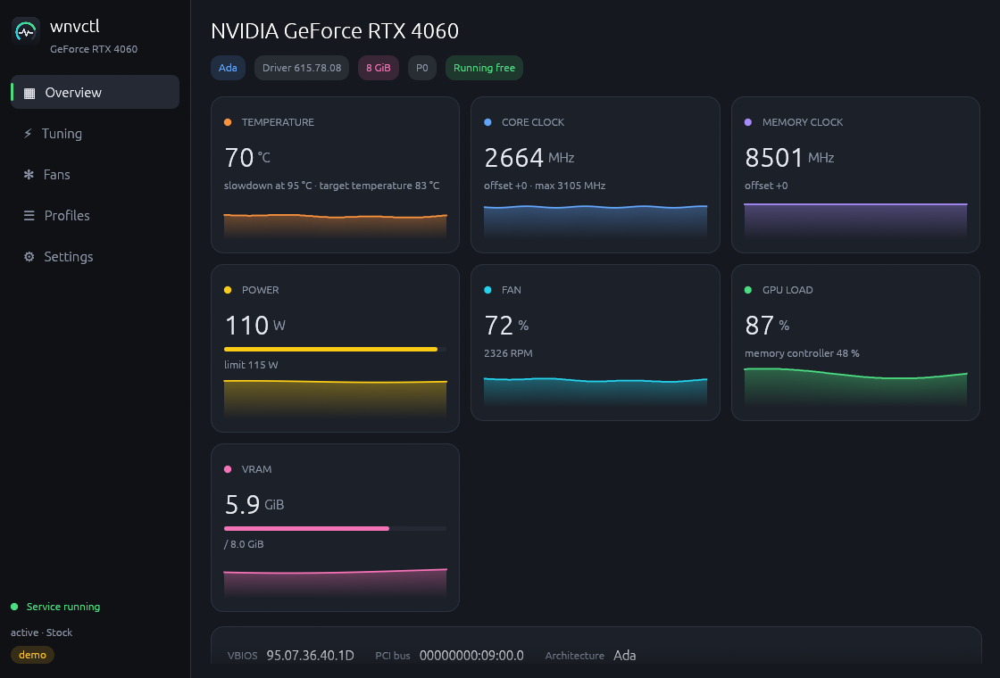
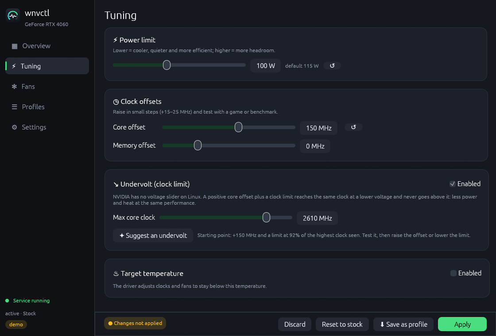
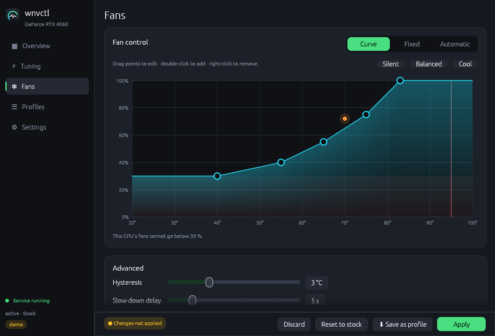

# wnvctl — NVIDIA GPU control for Linux

**English** · [Italiano](README.it.md)

Overclocking, undervolting, power limit, target temperature and fan curves for
NVIDIA GPUs on Linux, with a native **Wayland** (and X11) GUI and a CLI.
Written in Rust, inspired by [sLimit](https://github.com/ssprea/ssprea-nvidia-control).



| Tuning | Fan curve |
|---|---|
|  |  |

> Unofficial project, not affiliated with or endorsed by NVIDIA. Overclocking
> can make your system unstable; use it at your own risk.

## Features

- **Live monitoring**: temperature, core/memory clocks, power, fans (% and
  RPM), load, VRAM, P-state and what is limiting the clocks, with charts.
  Works without root and without the service.
- **Power draw on cards where `nvidia-smi` shows N/A** (e.g. RTX 4060): when
  the instant reading is unsupported, wnvctl averages the driver's power
  samples.
- **Power limit**, **core/memory clock offsets**, **target temperature**.
- **Undervolt**: NVIDIA exposes no voltage control on Linux; a positive core
  offset plus a **clock limit** reaches the same clock at a lower voltage and
  never goes above it. A button suggests a starting point.
- **Fan control**: automatic, fixed, or a **curve** edited by dragging points,
  with hysteresis and a slow-down delay so the fans never pulse.
- **Profiles** (plain TOML files), applied with one click, from the tray menu
  or from the CLI; one profile can be **applied at boot**.
- **No password prompts**: a small root service does the writes; members of
  `wheel` or `wnvctl` may use it.
- Warns when another program (CoolerControl, GreenWithEnvy…) is driving the
  fans. Re-applies your profile if the driver drops it (suspend/resume).
- English and Italian.

### What is different from sLimit

| | sLimit | wnvctl |
|---|---|---|
| Fan loop | ~20 NVML reads every 500 ms | 1 temperature read per tick, writes only on change |
| Temperatures above the last curve point | fan at **0 %** (table not filled) | last point's speed |
| Descending curve segments | unsigned underflow | correct |
| Hysteresis / slow-down delay | no | yes |
| Writes when applying a profile | everything | only what changed, memory offset first |
| Power draw on RTX 4060-class cards | N/A | from driver samples |
| Undervolt, target temperature | no | yes |
| Runtime | .NET + gRPC daemon | native Rust binaries (CLI+daemon ~3 MB) |

## Requirements

- NVIDIA proprietary driver (provides `libnvidia-ml.so.1`); offsets need a
  Maxwell or newer GPU with a recent driver (555+).
- systemd (for the service). Tested on Arch/CachyOS with KDE Plasma (Wayland).

## Installation

### Arch Linux (AUR)

```bash
yay -S wnvidia-control        # builds from source
yay -S wnvidia-control-bin    # prebuilt
```

Then enable the service:

```bash
sudo systemctl enable --now wnvctl
```

Your user must be in `wheel` (usual on Arch) or in the `wnvctl` group
(`sudo usermod -aG wnvctl $USER`, then log in again).

### Other distributions

Download the `linux-x86_64` archive from the
[releases](https://github.com/deddroid/wnvidia-control/releases), extract it and run:

```bash
./install.sh --service
```

This installs the GUI and CLI in `~/.local` and, with `--service` (asks for
sudo), the daemon in `/usr/local/bin` with its systemd unit.
`./install.sh --uninstall` removes everything.

### From source

```bash
cargo build --release
```

## Usage

Start **wnvctl** from the application menu (`wnvctl-gui`). Edit settings in
*Tuning* and *Fans*, then press **Apply**; save them with **Save as profile**.

Command line:

```bash
wnvctl status                       # sensors, settings, service state
wnvctl watch                        # live readings
wnvctl set --power 100              # watts ("default" to reset)
wnvctl set --core 150 --clock-max 2600   # undervolt
wnvctl set --mem 1000 --target-temp 80
wnvctl set --fan 60                 # fixed %, "auto" or "curve"
wnvctl apply Quiet                  # a saved profile (or a .toml file)
wnvctl startup Quiet                # apply at boot (--clear to remove)
wnvctl reset                        # driver defaults, fans automatic
wnvctl profiles
wnvctl power                        # only the power draw, e.g. "53 W"
```

### Power in MangoHud / GOverlay

On cards where the instant power reading is unsupported (MangoHud shows
`0W`), add these lines to `~/.config/MangoHud/MangoHud.conf` (or GOverlay's
custom options) instead of `gpu_power`:

```ini
custom_text=GPU W
exec=wnvctl power
```

Each call takes about 20 ms and MangoHud runs it outside the render thread.

Use `-g <index|UUID|PCI bus>` to pick a GPU when you have more than one.

### Profiles

Profiles live in `~/.config/wnvctl/profiles/*.toml`:

```toml
name = "Quiet"
power_limit_w = 95          # omit for the default
core_offset_mhz = 150
mem_offset_mhz = 0
core_clock_max_mhz = 2610   # omit for no limit
target_temp_c = 80          # omit to keep the driver value

[fan]
mode = "curve"              # "auto", "fixed" or "curve"
fixed_percent = 50
curve = [{ temp = 50, speed = 30 }, { temp = 75, speed = 60 }, { temp = 85, speed = 100 }]
hysteresis_c = 3.0
spindown_ms = 5000
interval_ms = 1000
```

### Files

| Path | Content |
|---|---|
| `~/.config/wnvctl/settings.toml` | GUI preferences |
| `~/.config/wnvctl/profiles/` | your profiles |
| `/etc/wnvctl/daemon.toml` | service options (allowed groups, watchdog) — optional |
| `/var/lib/wnvctl/startup.toml` | profile applied at boot |
| `/run/wnvctl/wnvctl.sock` | service socket |

Environment variables: `WNVCTL_DEMO=1` (simulated GPU, writes nothing),
`WNVCTL_SCREENSHOTS=<dir>` (saves a PNG of every page and exits),
`WNVCTL_CONFIG_DIR`, `WNVCTL_SOCKET`.

## Known limitations

- Settings applied by the driver are lost at reboot; use *Apply at boot*.
- NVML cannot read back the clock limit, so it is shown as last applied.
- Locked clocks may not survive suspend/resume; the watchdog re-applies the
  profile when it notices offsets or power limit were reset.
- Fans cannot go below the card's minimum (often 30 %) in manual mode; zero-RPM
  only works in automatic mode.
- Per-point voltage/frequency curve editing (NvAPI) is not implemented yet.

### Tested

On an RTX 4060 (driver 615.78): monitoring, power limit, target temperature,
core offset, clock limit, reset, fixed fan speed, fan curve and fans back to
automatic when the service stops. Not yet tested on hardware: memory offset,
multi-GPU, watchdog after suspend.

## Credits

- **deddroid** — author; **Claude** (Anthropic) — code.
- [sLimit / ssprea-nvidia-control](https://github.com/ssprea/ssprea-nvidia-control) — the base this project started from.
- [LACT](https://github.com/ilya-zlobintsev/LACT) — fan hysteresis/spin-down approach.
- [nvidia_oc](https://github.com/Dreaming-Codes/nvidia_oc) — target temperature and clock locking via NVML.
- [nvuv](https://github.com/doums/nvuv) and [PenguinBurner](https://github.com/jpietek/PenguinBurner) — undervolting ideas (offset + clock limit, write order).
- [nvml-wrapper](https://github.com/rust-nvml/nvml-wrapper), [egui](https://github.com/emilk/egui), [ksni](https://github.com/iovxw/ksni).

## License

[MIT](LICENSE)
